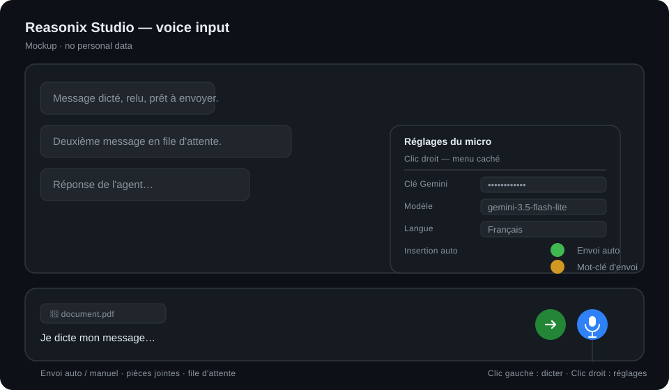

# Reasonix Voice Input

[](https://github.com/xtrem21-source/Reasonix-Voice-Input/releases)
[](LICENSE)
[](#)
[](#)
[](https://deepmind.google/technologies/gemini/)
[](docs/SUPPORTED-APPS.md)

> **Voice-input mic for Electron chat apps:** Gemini transcribes, inserts and sends (auto or
> manual), with attachments, queue and a hidden right-click menu. Ported to Reasonix Studio,
> Cline Desktop, Open Cowork and AionUi.
>
> **Start here:** [Tutorial](TUTORIAL.md) · [Tutoriel (FR)](TUTORIEL.fr.md).



*Mockup — no personal data.*

> **Unofficial project.** Not affiliated with, endorsed by, or supported by Reasonix Studio or
> DeepSeek. It patches a local copy of the app's static UI, is provided **as is**, without
> warranty, and may break on any app update. You must provide your own Gemini API key; no key
> is included.

> **Portable method.** The same module and the same 8-step method apply to other Electron chat
> apps. Reasonix Studio is the current target; AionUi 2.2.2 is supported by
> [`AionUi-Voice-Input`](https://github.com/xtrem21-source/AionUi-Voice-Input) using the same method.

| | |
|---|---|
| **App** | Reasonix Studio **2.40.0** (Electron + local host) |
| **Patched UI** | `resources\frontend-next\dist` — **plain files, no asar repack** |
| **Status** | runtime-validated on 2.40.0: mic, Gemini key, auto-send, queue, multi-pane anchoring; see §Status |
| **Module version** | 1 (`src/voice-input.reasonix.js`) |

## Signature — what makes it different

> **The mic lives in the chat, not in another app.** Left click records; **right-click opens
> the hidden settings menu**; the rest is about sending exactly how you want.

| Feature | Behavior |
|---|---|
| **Left click** | starts recording; click again to stop and transcribe |
| **Right-click** | opens the **hidden menu**: Gemini key, model, language, auto-insert, auto-send, send keyword |
| **Manual mode** | text is inserted; you review, edit, then send yourself |
| **Auto-send** | at stop, text is inserted **and sent automatically**; an attached file goes with it |
| **Attachments** | attach the file first, then dictate; text + file are sent together |
| **Queue** | if the agent is working, the message is **queued**; several messages can wait |
| **Force / fallback** | the module retries ~2 s; if the send button stays disabled, it shows an explicit error and copies the text; you can always click send/queue |
| **No separate app** | no server, no account, no extra window; the module only adds the mic |

**The strong point:** Gemini transcription is significantly better than Windows dictation
(Win+H), and the auto-send/queue/attachment workflow means you can dictate several messages
without touching the mouse — while keeping a manual mode when you want to review.

## Files

| File | Role |
|---|---|
| `src/voice-input.reasonix.js` | voice module adapted to Reasonix selectors and storage |
| `scripts/apply-patch.ps1` | patcher: verified backup, copy, script tag, check, reapply, rollback |
| `PREPARER-SAUVEGARDE-MIC-REASONIX.bat` | creates a **verified backup without patching** |
| `REAPPLIQUER-MIC-REASONIX.bat` | install / reinstall after a Reasonix update |
| `RESTAURER-MIC-REASONIX.bat` | **rollback** (works even if the app no longer starts) |
| `DESINSTALLER-MIC-REASONIX.bat` | alias for rollback |
| `VERIFIER-MIC-REASONIX.bat` | read-only check: tag, module hash, backup |
| `docs/` | inspection, method, journal, problems/solutions, version fingerprints |
| `docs/PROBLEMS-SOLUTIONS*.md` | problem → solution table |

## Install

1. Close or leave Reasonix Studio open — **the patcher never closes it**.
2. Recommended: `PREPARER-SAUVEGARDE-MIC-REASONIX.bat` — creates and verifies
   `index.html.bak` + `.sha256` **without modifying the app**.
3. `REAPPLIQUER-MIC-REASONIX.bat` — the patcher re-verifies the backup before any write.
   (In the French pack, `mettre-a-jour.bat` runs this step for you.)
4. **Reload (`Ctrl+R`) or relaunch Reasonix Studio.**
5. Right-click the mic → paste your Gemini key (`AIza…`) → **Save** → **Test the Gemini key**.

Command line:

```powershell
.\scripts\apply-patch.ps1 -ScriptPath .\src\voice-input.reasonix.js -Force
```

## Rollback — guaranteed before any write

The patcher **verifies the backup before modifying anything**; if the copy does not match,
it aborts. A checksum file is written: `index.html.bak.sha256`.

| Step | Command |
|---|---|
| Prepare a verified backup without patching | `PREPARER-SAUVEGARDE-MIC-REASONIX.bat` |
| Roll back | `RESTAURER-MIC-REASONIX.bat` (or `apply-patch.ps1 -Rollback`) |
| App no longer starts | close it (Task Manager if needed), run `RESTAURER-MIC-REASONIX.bat`, relaunch |
| Package lost | copy `index.html.bak` over `index.html`, delete `voice-input.js` |

Manual fallback:

```powershell
$fe = "$env:LOCALAPPDATA\Programs\Reasonix Studio\resources\frontend-next\dist"
Copy-Item "$fe\index.html.bak" "$fe\index.html" -Force
Remove-Item "$fe\voice-input.js" -Force -ErrorAction SilentlyContinue
```

The patch never touches `app.asar` or the host binary: only `index.html` and `voice-input.js`
in the static frontend. The app reference `index.html` is **not** shipped in this repository
(third-party file); see `docs/reference/README.md` to recreate it locally.

## Reapply after an app update

`frontend-next\dist` is replaced by the update → the patch disappears.

1. `REAPPLIQUER-MIC-REASONIX.bat` (or `PREPARER...` then `INSTALLER...`).
2. Reload / relaunch.
3. `VERIFIER-MIC-REASONIX.bat` should report:
   `html tagged = True`, `voice-input.js present = True`, `hash matches source = True`,
   `backup present = True`, `backup sha256 = True`.

## Exact changes

| File | Change |
|---|---|
| `…\frontend-next\dist\voice-input.js` | added |
| `…\frontend-next\dist\index.html` | one `<script src="./voice-input.js"></script>` before `</body>` |
| `…\frontend-next\dist\index.html.bak` | backup of the original |
| `…\frontend-next\dist\index.html.bak.sha256` | checksum of the backup |

## Reasonix selectors (2.40.0)

- Composer: `textarea[data-action-keydown="session.send"][role="combobox"]`
- Send: `button.btn.send[data-action="session.send"]`
- Stop (anchoring only, never clicked): `button.btn.stop[data-action="session.stop"]`
- Queue: `queue.send-now`, `queue.cancel`, `queue.edit`, `queue.pause`, `queue.retry`
- Storage keys use the `rx-` prefix so Reasonix's preload persists them across launches.

## Portable method — other apps

The module is app-agnostic; only the selectors, storage keys and preload APIs change.

| App | UI location | Patch type | State |
|---|---|---|---|
| [Reasonix Studio 2.40.0](https://github.com/esengine/DeepSeek-Reasonix) | `frontend-next\dist` (plain) | copy + one script tag | **ported and validated** |
| [Cline Desktop](https://github.com/cline/cline) | Electron app | same module + selectors | **ported**; anchoring to adjust |
| [Open Cowork](https://github.com/open-cowork/open-cowork) | Electron app | same module + selectors | **ported** (base) |
| [AionUi 2.2.2](https://github.com/iOfficeAI/AionUi) | `resources\app.asar` | asar repack with `--unpack` | **ported and validated** |

The 8 generic steps are in [`docs/METHODOLOGY.md`](docs/METHODOLOGY.md) (EN) and
[`docs/DEMARCHE.md`](docs/DEMARCHE.md) (FR):

1. Locate the composer, send and stop controls; record stable selectors.
2. Determine whether the UI is plain or inside an asar.
3. Plain UI: copy the module + one script tag; asar: extract, preserve
   `app.asar.unpacked`, repack with `--unpack-dir` / `--unpack`, verify the manifest.
4. Adapt storage keys to the app's persistence (e.g. `rx-` in Reasonix).
5. Adapt preload APIs (external links, config/logs availability).
6. Anchor the mic in the real action row; never anchor onto itself; float above when narrow.
7. Verify: no renderer freeze, clickable mic, key test, recording, insertion, auto-send, queue.
8. Keep a verified rollback (`.bak` + checksum, or `app.asar.bak` + unpacked manifest).

> **Why Gemini?** Gemini transcription is significantly more accurate and better punctuated
> than Windows dictation (**Win+H**), especially for technical terms and long messages. That
> is the module's main advantage; Windows remains an offline/no-key fallback.

> **For an agent:** [`AGENT-PLAYBOOK.md`](AGENT-PLAYBOOK.md) (EN) /
> [`FICHE-AGENT.fr.md`](FICHE-AGENT.fr.md) (FR) is a copy-paste roadmap. It covers ~95% of the
> port; the last 5% are exact selectors and anchoring measurements — small adjustments, not a
> constraint.

## Status / to validate

| Point | State |
|---|---|
| Mic button, anchoring, resize | validated on 2.40.0 |
| Gemini key, test button, transcription | validated |
| Auto-send, queue while the agent works | validated |
| CSP / host headers, sandboxed `fetch` | validated at runtime |
| UI language of the module | French (v1); docs are FR/EN |

## Traceability

| File | Role |
|---|---|
| [`docs/INSPECTION-2026-10-18.md`](docs/INSPECTION-2026-10-18.md) / [`.en.md`](docs/INSPECTION-2026-10-18.en.md) | inspection, selectors, risks — FR/EN |
| [`docs/DEMARCHE.md`](docs/DEMARCHE.md) / [`docs/METHODOLOGY.md`](docs/METHODOLOGY.md) | method — FR/EN |
| [`docs/JOURNAL.md`](docs/JOURNAL.md) / [`docs/JOURNAL.en.md`](docs/JOURNAL.en.md) | append-only journal — FR (authoritative) / EN mirror |
| [`docs/PROBLEMS-SOLUTIONS.md`](docs/PROBLEMS-SOLUTIONS.md) / [`.en.md`](docs/PROBLEMS-SOLUTIONS.en.md) | problems/solutions — FR/EN |
| [`docs/VERSION-REASONIX.md`](docs/VERSION-REASONIX.md) / [`.en.md`](docs/VERSION-REASONIX.en.md) | 2.40.0 fingerprints — FR/EN |
| [`CHANGELOG.md`](CHANGELOG.md) / [`CHANGELOG.fr.md`](CHANGELOG.fr.md) | versions — EN/FR |
| [`docs/PUBLICATION.md`](docs/PUBLICATION.md) | publication checklist — FR/EN |
| [`SECURITY.md`](SECURITY.md) | key handling and reporting — FR/EN |

## Tags

`voice-input` · `speech-to-text` · `dictation` · `gemini` · `electron` · `reasonix-studio` ·
`cline-desktop` · `open-cowork` · `aionui` · `productivity` · `accessibility` · `windows`

## License

MIT — see [`LICENSE`](LICENSE). The app itself is not distributed here; its name and trademarks
belong to their owners.
